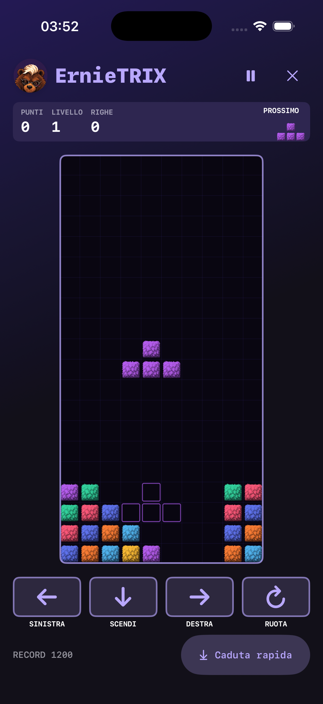

# ErnieTRIX

Gioco locale per iPhone, introdotto nella build 101. Campo 10 × 20,
sette tetramini, rotazione oraria con correzioni vicino a pareti e pavimento,
eliminazione delle righe complete. La distribuzione usa sacchetti mescolati
di sette forme; il prossimo pezzo e la sagoma di atterraggio sono visibili.

## Accesso

- Scrivere o dettare «Voglio giocare a ErnieTRIX», «Apri ErnieTRIX» o
  «Giochiamo a Ernie trix». Il riconoscimento avviene nel punto di ingresso
  condiviso di testo e trascrizione vocale, prima dell'invio al server.
- In alternativa, voce **ErnieTRIX** nel pannello laterale.
- Il gioco apre una schermata intera sopra la chat. Chiuderla salva la partita.
- Le domande sul gioco, le negazioni, i comandi composti e i messaggi con
  allegati continuano ad arrivare normalmente a Ernie. Il comando locale non
  genera un turno, una risposta vocale o una richiesta di rete.

## Interazione

Sinistra, destra e discesa rispondono al tocco e si ripetono tenendoli premuti;
la rotazione avviene una volta per tocco. **Caduta rapida** posa immediatamente
il pezzo sulla sagoma. I quattro comandi principali hanno dimensione minima
44 punti, etichette VoiceOver e cancellano la ripetizione quando il dito esce,
il tocco viene annullato o la partita viene messa in pausa.

Il contatto con il fondo concede 0,5 secondi per sistemare il pezzo; gli
spostamenti possono azzerare questa attesa al massimo quindici volte.
Una, due, tre e quattro righe valgono rispettivamente 100, 300, 500 e 800 punti
moltiplicati per il livello. Discesa manuale: 1 punto/casella; caduta rapida:
2 punti/casella. Ogni dieci righe aumenta il livello e accelera la gravità.
La partita finisce se il prossimo pezzo è bloccato o un pezzo si fissa sopra
il bordo superiore. Non sono implementati hold, T-spin o punteggi competitivi.

## Grafica e ciclo di vita

SpriteKit disegna il campo; SwiftUI gestisce intestazione, punteggio e pad.
Lo sprite di pelliccia è incluso in `Assets.xcassets/ErnieTRIXFur.imageset`.
Il renderer lo colora una volta in sette texture da 64 × 64 pixel, con
filtraggio nearest-neighbour, conservate in cache: nessuna immagine scaricata
o generazione LLM durante il gioco. Sprite originale creato con il tool
imagegen integrato il 24 ottobre 2026; prompt: «single front-facing square
block of shaggy bear fur, crisp pixel art, neutral grayscale ivory, broad
pointed tufts, transparent background, no face, no text, for runtime tinting».
L'orso usa gli atlanti esistenti. Gli accenti seguono il costume selezionato;
il campo resta scuro e i sette colori dei pezzi rimangono distinguibili.
Riduci movimento disattiva il lampo decorativo delle righe eliminate.

Dalla build 102 un `SKView` gestito da `UIViewRepresentable` presenta la scena
e sincronizza esplicitamente avvio, pausa e ripresa. Disegna il primo frame
anche quando la partita è in pausa, poi sospende il ciclo fino alla ripresa.
Il clock viene azzerato a ogni transizione, evitando recuperi del tempo sospeso.
`SpriteView` conservava invece la pausa iniziale e lasciava il campo grigio
anche dopo «Gioca». La preview Debug parte ora in pausa come il flusso reale.

La scena si ferma in pausa; al passaggio in background o alla perdita di
attività dell'app la partita viene salvata e non riparte senza un tocco.
La conversazione continua e la voce vengono fermate all'apertura del gioco.
Un turno di chat già in corso può terminare per iscritto.

## Dati

Partita e record sono locali, separati tramite hash delle credenziali del
server/account; le credenziali non vengono scritte nel salvataggio.
Una chiave API nuova ha uno spazio di gioco distinto. Non c'è sincronizzazione
fra dispositivi, classifica online o proiezione nel Second Brain.
Il checkpoint include campo, forma corrente, coda casuale e punteggio; si
aggiorna al fissaggio dei pezzi, in pausa e alla chiusura. I dati corrotti o di
una versione non riconosciuta vengono ignorati, senza accessi fuori indice.

## Verifica

`ErnieTRIXRulesTests`: forme, distribuzione, collisioni, rotazioni, righe,
punteggi, sagoma, gravità, pausa, limite ai reset, fine partita, dati corrotti
e distinzione tra comandi di apertura e altre richieste.
`ErnieTRIXIntegrationTests`: ripresa esatta in pausa, record, separazione
account, apertura testo/voce offline senza turno inviato.
`ErnieTRIXViewTests`: layout nativo a 390 e 320 punti, palette classica/Borg,
comandi touch/pressione prolungata, accessibilità e sospensione dell'app.
Regressione 102: apertura inizialmente in pausa, avanzamento reale di SpriteKit
senza comandi, pixel del campo visualizzato, pausa/ripresa e riapertura del
salvataggio. Il test fallisce sulla build 101 (il pezzo resta alla stessa quota).

Nessun deployment backend richiesto. Stato del rilascio in
[build-102.md](../releases/build-102.md).

## Resa nativa verificata

## Provenienza dello sprite

File: `apps/ios/Ernie/Assets.xcassets/ErnieTRIXFur.imageset/fur.png`.
Generato con il tool imagegen integrato, modalità trasparente, senza CLI o
API a carico del backend Ernie. Prompt completo:

> Create a single production game sprite, not a mockup: one front-facing SQUARE BLOCK made of thick shaggy bear fur for a pixel-art falling block puzzle called ErnieTRIX. Transparent background. Only one square, filling 94 percent of the canvas, centered, front orthographic view, no perspective, no visible side faces, no scene, no text, no shadow outside. Style: beautiful crisp 64x64 pixel art upscaled with hard square pixels, detailed but strongly readable large layered tufts. Neutral grayscale ivory white fur with medium gray shadows and dark gray at lower edge. Broad pointed clumps of fur sweep downward and outward like a bear's cheek, with larger coherent triangular tufts, NOT random dots or confetti. Top edge softly tufted, side fur extends only one or two pixels, bottom roughly square. Square silhouette unmistakable for interlocking square grid cells. Soft bevel implied by light fur at top and left, shaded fur bottom and right. No face, eyes, paws, limbs, decorations, colored tint or border frame. This will be tinted into seven colors by the game's renderer; preserve rich luminance variation with highlights and shadows. Exact square composition, transparent outside fur silhouette.
