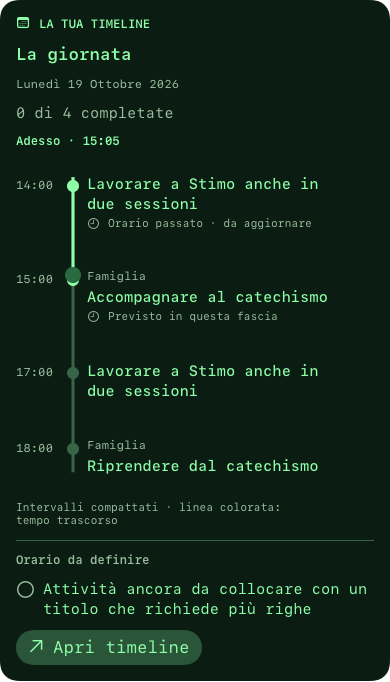

# Timeline Todo nella chat

23 ottobre 2026, build 100.

## Diagnosi

Una lista oraria persistita su staging3 aveva `mode: scheduled`, tre slot e
`reminderMinutes: null`. La scheda chat `TodoCard` ignorava sempre modalità e
slot e mostrava solo i primi quattro titoli. Il dettaglio aveva già la timeline.
Nessuna modifica dei dati dell’account o degli avvisi è stata necessaria.

## Correzione

La scheda usa `TodoCardContent` e la stessa `TodoTimeline` del dettaglio,
con righe compatte e aggiornamento ogni minuto. Le liste semplici mantengono
l’elenco; le liste orarie mostrano tutte le sessioni in ordine cronologico,
la data, l’ora corrente e le attività senza slot in una sezione distinta.
La linea segue la palette dell’orso. Il tempo trascorso non completa i task.
Il marcatore compare soltanto nell’intervallo pianificato, evitando di coprire
il primo orario quando la giornata deve ancora iniziare. Toccare una tappa o
Apri timeline apre il dettaglio della stessa lista, senza scritture automatiche.

## Verifica

- Riproduzione prima della correzione: fallivano i controlli che confrontano
  il rendering cambiando orario, modalità e una fascia dopo la quarta.
- Dopo la correzione: 23 test Todo in 4 suite passati su simulatore iOS 26.5.
- Release: 3 test della scheda passati con `ENABLE_TESTABILITY=YES` e
  `ONLY_ACTIVE_ARCH=YES`; la prima invocazione senza testability non poteva
  importare il modulo per i test. Nessun ciclo AttributeGraph nei due log finali.
- Rendering nativo a 320 e 390 punti, tema chiaro/scuro, classico/Borg e testo
  standard/accessibilità; anteprime ispezionate. Nessuna prova su iPhone fisico.
- Nessuna modifica backend, nessuna chiamata LLM richiesta dalla timeline.

